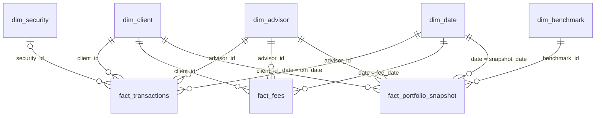

# HW5 Star Schema Design: Wildcat Capital
MIS3060 Business Intelligence with AI | Charlie Goldsmith

The eight clean Wildcat Capital tables form a star schema with three fact tables and five dimensions. Every number below comes from `scripts/01_star_checks.py`, which stops on the first failed assert and writes its evidence to `reports/`.

The diagram shows the 11 active relationships. The two dimension-to-dimension keys (`dim_client[advisor_id]` and `dim_security[benchmark_id]`) sit in the model as inactive relationships; Part E (b) and (d) explain why.

---

## Part A: Keys

| Table | Type | Primary key | Foreign keys (column → table[column]) |
|---|---|---|---|
| dim_advisor | Dimension | `advisor_id` | — |
| dim_benchmark | Dimension | `benchmark_id` | — |
| dim_client | Dimension | `client_id` | `advisor_id` → dim_advisor[advisor_id] |
| dim_date | Dimension | `date_id` | — |
| dim_security | Dimension | `security_id` | `benchmark_id` → dim_benchmark[benchmark_id] |
| fact_fees | Fact | `fee_id` | `client_id` → dim_client[client_id] `advisor_id` → dim_advisor[advisor_id] `fee_date` → dim_date[date] |
| fact_portfolio_snapshot | Fact | `snapshot_id` | `client_id` → dim_client[client_id] `advisor_id` → dim_advisor[advisor_id] `benchmark_id` → dim_benchmark[benchmark_id] `snapshot_date` → dim_date[date] |
| fact_transactions | Fact | `txn_id` | `client_id` → dim_client[client_id] `advisor_id` → dim_advisor[advisor_id] `security_id` → dim_security[security_id] (blank on 101,528 cash rows) `txn_date` → dim_date[date] |

All eight primary keys are unique and never blank. This is because `pk_checks.csv` shows the distinct count equal to the row count for every table: 25 advisors, 8 benchmarks, 2,500 clients, 1,827 dates, 500 securities, 122,197 fees, 129,547 snapshots and 298,572 transactions. Each key is a whole number, which matches the Whole Number type Power BI needs on both sides of a relationship.

All 13 foreign keys match their target at 100%. This is because `fk_checks.csv` reports zero orphans for each one. `fact_transactions[security_id]` is the one key that can be blank: 101,528 rows have no security, and all of them are Deposit, Withdrawal or Advisory Fee rows. The facts store calendar dates such as `2024-12-01`, so each fact date points to `dim_date[date]`. No fact date value appears in `dim_date[date_id]`, and `dim_date[date]` is also unique, so it can sit on the one side of a relationship.

---

## Part B: Grain

- **fact_transactions:** One row represents one transaction (a buy, sell, dividend, deposit, withdrawal or advisory fee debit) for one client on one date, identified by `txn_id`.
- **fact_fees:** One row represents the single fee charged to one client for one month, dated on the first of that month.
- **fact_portfolio_snapshot:** One row represents one client's account balance and year-to-date performance for one month, dated on the first of that month.

Each grain holds in the data. This is because `grain_checks.csv` finds zero duplicate `txn_id` values in fact_transactions, zero duplicate `client_id + fee_date` pairs in fact_fees, and zero duplicate `client_id + snapshot_date` pairs in fact_portfolio_snapshot. fact_transactions has no business-column grain: `client_id + txn_date + txn_type + security_id` repeats on 622 rows, which are same-day repeat trades. That makes `txn_id` the only column set that identifies a transaction.

---

## Part C: Measures

### Fact measures

| Table | Column | Class | How it may be summed or averaged |
|---|---|---|---|
| fact_transactions | `amount` | Additive | SUM works across clients, advisors, securities and dates, but every amount is positive, so keep `txn_type` on the visual or deposits and withdrawals add together as gross activity. |
| fact_transactions | `shares` | Semi-additive | SUM works across clients and dates for one security and one `txn_type`; a total across 500 different securities or across buys and sells counts no real quantity. |
| fact_transactions | `price` | Non-additive | A per-share price never sums; average it within one security, weighted by `shares`. |
| fact_fees | `amount` | Additive | SUM works across every dimension; the $204,675,583.12 total is the fee revenue charged from 2020 to 2024. |
| fact_fees | `aum_basis` | Semi-additive | SUM works across clients inside one month, but not across months, because it is the same month-start balance as snapshot `aum` (100% match on client and month). |
| fact_fees | `bps_charged` | Non-additive | A fee rate never sums; average it weighted by `aum_basis` (45.6109 bps), since the simple average (75.9904 bps) gives a small account the same weight as a large one. |
| fact_portfolio_snapshot | `aum` | Semi-additive | SUM works across clients, advisors and benchmarks inside one month, but across months it stacks balances: summing 2024 gives $135,459,843,783.73, 10.64 times the December 2024 total of $12,729,572,078.86. |
| fact_portfolio_snapshot | `return_ytd` | Non-additive | A cumulative ratio never sums; take the latest month for one client, or an `aum`-weighted average across clients. Client 1's twelve 2024 values sum to 1.234084, while the real December figure is 0.236041. |
| fact_portfolio_snapshot | `benchmark_return_ytd` | Non-additive | A cumulative index return never sums; read the latest month for one benchmark. |
| fact_portfolio_snapshot | `active_alpha_ytd` | Non-additive | It equals `return_ytd - benchmark_return_ytd` on every row (max gap 0.000001), so it follows the same rule: latest month, `aum`-weighted across clients. |
| fact_portfolio_snapshot | `cash_pct` | Non-additive | A share of one account's balance (0.01 to 0.08) never sums; average it weighted by `aum` (0.044062 in December 2024). |

### Numeric columns that are not measures

- **Keys:** `txn_id`, `fee_id`, `snapshot_id`, and every `client_id`, `advisor_id`, `security_id` and `benchmark_id` on the facts. They identify rows and link tables; set Summarize to "Don't summarize."
- **Date parts:** `year` and `month` on fact_portfolio_snapshot. They repeat `snapshot_date`, which the script confirms on all 129,547 rows.
- **Flags:** `is_post_departure_txn` (1 on the 2,410 transactions dated after an inactive client's last snapshot) and `is_return_suspect` (1 on 3,875 snapshots). SUM gives a count of flagged rows, which is a row count and not a business amount.
- **Text that looks numeric:** `account_type` holds values such as `529`, an account type name. Load it as Text.

### Numeric attributes in the dimensions that should never be summed

- **dim_advisor:** `years_experience` and `aum_target_mm` describe one advisor; a total across advisors means nothing, so average or group by them.
- **dim_client:** `age`, `initial_aum` and `zip_code`. `initial_aum` is each client's balance on their own `client_since` date, which spans different years, so a total mixes dates. `zip_code` is an identifier stored as Text.
- **dim_security:** `expense_ratio_bps` is a rate, blank on the 281 non-ETF rows; average it.
- **dim_date:** `year`, `quarter`, `month`, `week_of_year` and the four `is_*` flags are calendar labels for grouping and filtering.
- **Dimension keys:** `advisor_id` in dim_client and `benchmark_id` in dim_security.

---

## Part D: Model built in Power BI

| # | From (many side) | To (one side) | Cardinality | Cross-filter | Active |
|---|---|---|---|---|---|
| 1 | fact_transactions[client_id] | dim_client[client_id] | \*:1 | Single | Yes |
| 2 | fact_transactions[advisor_id] | dim_advisor[advisor_id] | \*:1 | Single | Yes |
| 3 | fact_transactions[security_id] | dim_security[security_id] | \*:1 | Single | Yes |
| 4 | fact_transactions[txn_date] | dim_date[date] | \*:1 | Single | Yes |
| 5 | fact_fees[client_id] | dim_client[client_id] | \*:1 | Single | Yes |
| 6 | fact_fees[advisor_id] | dim_advisor[advisor_id] | \*:1 | Single | Yes |
| 7 | fact_fees[fee_date] | dim_date[date] | \*:1 | Single | Yes |
| 8 | fact_portfolio_snapshot[client_id] | dim_client[client_id] | \*:1 | Single | Yes |
| 9 | fact_portfolio_snapshot[advisor_id] | dim_advisor[advisor_id] | \*:1 | Single | Yes |
| 10 | fact_portfolio_snapshot[benchmark_id] | dim_benchmark[benchmark_id] | \*:1 | Single | Yes |
| 11 | fact_portfolio_snapshot[snapshot_date] | dim_date[date] | \*:1 | Single | Yes |
| 12 | dim_client[advisor_id] | dim_advisor[advisor_id] | \*:1 | Single | No |
| 13 | dim_security[benchmark_id] | dim_benchmark[benchmark_id] | \*:1 | Single | No |

`dim_date` is marked as the date table on `dim_date[date]`. Column types follow `reports/powerbi_types.csv` (one row for each of the 77 columns). The row counts Power BI shows in Table view reconcile to `reports/row_counts.csv`: 25 advisors, 8 benchmarks, 2,500 clients, 1,827 dates, 500 securities, 122,197 fees, 129,547 snapshots and 298,572 transactions.

---

## Part E: Relationships and design questions

The model has three conformed dimensions: `dim_client`, `dim_advisor` and `dim_date` each filter all three fact tables. `dim_security` filters fact_transactions alone, and `dim_benchmark` filters fact_portfolio_snapshot alone.

**(a) Blank `security_id`.** The 101,528 transaction rows without a `security_id` are cash movements, and the blank is correct. This is because every blank falls on one of three cash types: 35,956 Deposit rows, 29,830 Withdrawal rows and 35,742 Advisory Fee rows. A deposit, a withdrawal or a fee debit moves cash in or out of the account and buys no security, so these rows also have blank `shares` and `price`. The script asserts the reverse as well: no Buy, Sell or Dividend row has a blank security. In Power BI the cash rows appear as a `(Blank)` row when you group transactions by `dim_security[ticker]`, and that row is expected structure.

**(b) `advisor_id` in four places.** I kept the three direct fact-to-advisor relationships active (rows 2, 6 and 9) and left `dim_client[advisor_id]` → `dim_advisor` inactive (row 12). This is because Power BI allows one active filter path between two tables, and the direct path and the path through dim_client give the same answer today: 0 of 550,316 fact rows carry an advisor that differs from the client's advisor in dim_client. With equal answers, I chose the direct path for two design reasons. A dim_advisor slicer reaches each fact in one hop, which keeps the model a star. The `advisor_id` on a fact row also records the advisor who served that transaction, fee or month, while dim_client holds one current advisor per client. If Wildcat Capital reassigns a client next year, the fact rows keep the history and the dim_client path would move all of it to the new advisor.

**(c) Joining on `date`, not `date_id`.** I joined each fact date column to `dim_date[date]`. This is because the fact columns hold calendar dates and `date_id` holds the integers 1 to 1,827: no `txn_date`, `fee_date` or `snapshot_date` value matches a `date_id`, while all 550,316 fact dates match a `date` value. A join to `date_id` would also pair a Date column with a Whole Number column, and every fact row would land in `(Blank)`. Marking `dim_date` as the date table requires the `date` column too, so the same column serves both. One side effect to remember for Assignment 6: fees and snapshots fall on the first of each month, while `dim_date[is_month_end]` flags the last day, so a filter on `is_month_end = 1` removes every fee and snapshot row.

**(d) Star or snowflake.** Two links connect one dimension to another: `dim_client[advisor_id]` → `dim_advisor` and `dim_security[benchmark_id]` → `dim_benchmark`. I kept both in the model as inactive relationships, so the active model is a star. The advisor link stays inactive for the reason in (b). The benchmark link stays inactive because `dim_benchmark` plays two different roles. On fact_portfolio_snapshot, `benchmark_id` is the client's portfolio benchmark, set by risk profile, and it uses ids 1, 3 and 8 (S&P 500, 60/40 Blend, Conservative Blend). On dim_security, `benchmark_id` is the index a security tracks, and it uses ids 1, 2, 3, 4, 5 and 7. With both active, one dim_benchmark slicer set to "S&P 500" would filter snapshots to aggressive portfolios and transactions to equity trades at the same time, two meanings in one filter. Assignment 6 can switch the security link on inside a single measure with `USERELATIONSHIP` when a question needs it.

---

## Part F: Reflection

**1. Fees: "How much fee revenue did each advisor region earn in each quarter of 2024, by fee type?"** The model answers this in a single visual with no DAX workaround. This is because `fact_fees[amount]` is additive and `dim_advisor` and `dim_date` both filter fact_fees in one hop, so a matrix with `dim_advisor[region]` on rows, `dim_date[quarter]` and `fee_type` on columns, a `dim_date[year] = 2024` filter, and Sum of `amount` returns the right totals. The fee figure has to come from fact_fees: the Advisory Fee debits in fact_transactions total $263,709,737.13, which is $59,034,154.01 more than the $204,675,583.12 fact_fees charged, so the two tables record different events.

**2. Snapshots: "How much AUM did each advisor manage at the end of each year from 2020 to 2024?"** The model cannot answer this in a single visual without DAX. This is because `aum` is semi-additive and Power BI's default aggregation is SUM: with `dim_date[year]` on the axis, each year adds up twelve monthly balances, and for 2024 that overstates AUM by 10.64 times. A filter on December fixes one year at a time, and `dim_date[is_month_end]` does not help because no snapshot falls on a month-end date (see (c)). To fix it in the schema, I would add an `is_last_snapshot_of_year` flag to fact_portfolio_snapshot, set to 1 on each client's latest snapshot in each year. One visual with advisor and year on the axes, Sum of `aum`, and that flag as a filter would then return year-end AUM for every year at once.

**3. Transactions: "What was each advisor's net new money (deposits minus withdrawals) in 2024?"** The model cannot answer this in a single visual without DAX. This is because `fact_transactions[amount]` is positive on every row, so a Sum of `amount` across Deposit and Withdrawal adds the two instead of netting them. A matrix can show the two types side by side, but the net figure ($327,439,026.62 across 2020 to 2024) needs a measure that flips the sign on withdrawals. To fix it in the schema, I would add a small `dim_txn_type` table with a `net_flow_sign` column (+1 for Deposit, -1 for Withdrawal, 0 for the other four types) and a `signed_amount` column on fact_transactions equal to `amount` times that sign. Net new money then becomes a plain Sum of `signed_amount` on one visual.

The model answers additive questions about fees and transaction volume in one visual. Questions about balances over time and net cash flow need either the Assignment 6 measures or the two schema changes above.
